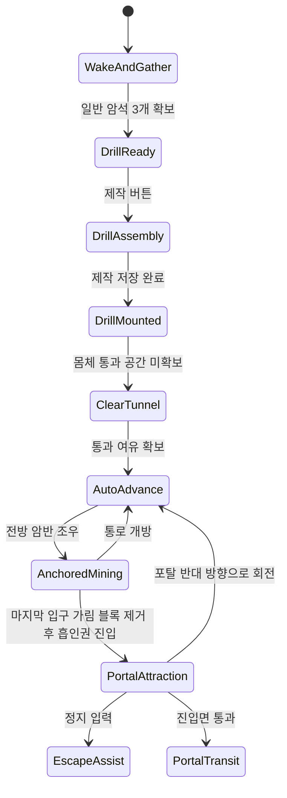

# DIG 4D 인트로·자동 채굴 구현 상세설계

2026-11-25 · 첫 실행부터 입구 포탈 통과까지의 플레이 흐름과 조작/UI 계약

## 1. 목표와 설계 범위

첫 플레이에서 설명문이나 조작 메뉴 대신 어둠, 점등, 레이저음, 암석 수집, 드릴 장착, 자동 전진을 통해 기계의 작동을 체험하게 한다. 사용자는 시야 방향을 바꾸고 현재 표시된 버튼만 누른다. 이동 조이스틱·수동 추진은 제공하지 않는다.

이 문서는 4D 모드 첫 진입부터 첫 입구 포탈을 통과하거나 흡인에서 벗어나는 구간을 다룬다. 일반 청크 포탈 출현, 거래, 온라인 기능의 세부 구현은 포함하지 않는다. 솔로 세계관 암시 대사 규칙은 [스토리 단서 상세설계](dig-4d-implementation-detail-20261125.md)를 따른다.

## 2. 플레이 단계 상태 머신



- `WakeAndGather`: 첫 프레임은 어둡고 기계는 충돌하지 않는 최소 시작 공간에 놓인다. 작업등은 순차 점등하며 동시에 기본 레이저가 전방 일반 암석을 자동 분해한다. 레이저 소리는 점차 커지고 일반 암석 수량을 처음부터 표시한다. 조명·음량 연출은 광물 수집·충돌 규칙을 지연시키지 않으며 전역 주변광은 올리지 않는다. 조작 안내·메뉴 버튼은 없다.
- `DrillReady`: 수량이 3에 도달하면 암석 수량 HUD와 드릴 제작 버튼만 보인다. 추가 수집은 허용하되 버튼은 계속 유지한다.
- `DrillAssembly`: 버튼 입력을 한 번의 원자적 제작 요청으로 처리한다. 자원 부족·저장 오류 시 중복 차감 없이 제작 전 화면을 유지하고 재시도 가능 메시지를 표시한다.
- `DrillMounted`: 제작 성공 후 드릴 개체를 기계 전방 장착점에 자동 부착하고 저장한다. 자동 채굴 또는 전진이 실행 중일 때 정지 버튼을 표시한다. 기계는 앞을 막은 암반을 자동 채굴하지만, 아직 몸체가 통과할 폭이 아니면 전진하지 않는다. 작업이 멈추고 안전하게 재개할 수 있을 때만 재개 버튼을 표시한다.
- `ClearTunnel`: 드릴은 기계 충돌체 전체가 지나갈 폭과 높이를 확보할 때까지 채굴한다. 몸체 폭 판정은 실제 sphere collider 반경에서 계산하고, 메시/애니메이션 크기를 기준으로 삼지 않는다.
- `AutoAdvance`: 통로에 충돌 여유가 생기면 플레이어 시야가 가리키는 방향으로 자동 전진한다. 시야 회전은 다음 자동 전진 방향을 갱신한다.
- `AnchoredMining`: 앞에 암반이 있으면 자동 속도를 0으로 감속하며 채굴한다. 체인은 기계 몸체의 고정점에서 발사되어 주변의 안정된 암반에 걸리고 채굴 반동을 억제한다. 통과 폭이 열리면 체인을 회수한 뒤 전진한다.
- `PortalAttraction`: 시작 청크에서만 보장된 입구 포탈의 진입면을 막은 마지막 광석 블록이 제거된 뒤 활성화한다. 흡인 가속은 거리·상대 방향에 따라 연속적으로 변한다.
- `PortalTransit`: 순간 위치 스냅이 아니라 이동체가 진입면을 실제로 통과하는 물리 이벤트로 처리한다. 연결된 목적지와 시간 정보는 플레이어에게 표시하지 않는다.

## 3. 인트로 HUD 및 입력 계약

| 상태 | 표시 요소 | 허용 입력 |
| --- | --- | --- |
| 암전·점등·레이저 수집(암석 0~2) | 일반 암석 수량만 | 시야 방향 변경 |
| 암석 3개 이상 | 암석 수량, 드릴 제작 | 시야 변경, 드릴 제작 클릭 |
| 자동 채굴/전진 실행 중 | 정지 버튼, 관련 조건에 도달한 센서 메시지 | 시야 변경, 화면에 표시된 버튼 |
| 메뉴/거래/복원 | 해당 패널과 그 안의 버튼 | 패널 버튼; 자동 이동/채굴은 안전 규칙에 따라 정지 |

- 첫 드릴 제작 성공 전에는 단계표의 암석 카운터와 제작 조작만 제공한다. 장착 후에는 메뉴를 열 수 있다.

| 운행 상태 | 정지 | 재개 | 다음 동작 |
| --- | --- | --- | --- |
| 장착 후 자동 채굴·전진 실행 중 | 표시 | 숨김 | 누르면 채굴·추진을 중단하고 제동한다. |
| 제동 중, 패널 열림, 저장 충돌 또는 청크 준비 중 | 숨김 | 숨김 | 정지 원인을 표시하고 입력을 기다린다. |
| 장착 상태로 정지, 패널 닫힘, 저장·청크·충돌 조회 정상, 실행할 채굴 또는 전진 작업 있음 | 숨김 | 표시 | 눌렀을 때 조건을 다시 확인하고 해당 작업을 시작한다. |

메뉴를 열면 먼저 작업을 중단하고 제동한다. 패널을 닫으면 정지 상태를 유지하고 위 표에 따라 버튼을 다시 계산한다.
- 화면 드래그는 카메라 방향과 전방 자동추진 방향을 바꾼다. 별도 스틱·WASD·화면 빈 영역의 추진 터치는 없다.
- `정지`는 자동 전진 명령을 해제한다. 포탈 흡인 중에는 정지 동작이 물리적 역추력 제동을 함께 요청해 흡인권 밖으로 빠져나오도록 한다. 일반 상황에서는 기존 속도와 관성을 제동한 뒤 정지 상태를 유지한다.
- 정지 상태에서 방향만 포탈 반대로 돌리면 자동 전진이 재개될 때 역추력이 포탈 바깥쪽을 향한다. 속도·포탈 힘·기계 추력 한계를 고려해 실제로 탈출할 수 있어야 한다. 무한 추력이나 위치 고정은 금지한다.
- 터치 취소, 화면 회전, 앱 비활성화, 복원 패널 열기 시 누름 상태와 자동추진 명령을 안전하게 초기화한다.

## 4. 수집 및 드릴 제작 트랜잭션

- 암석은 실제 레이저 채굴 완료 이벤트에서 한 번만 지급한다. 화면 카운터는 인벤토리의 일반 암석 수량과 같은 원본 값을 읽는다.
- 인트로 시작 시 기존 세이브를 자동 초기화하지 않는다. 새 게임/처음부터 다시 시작 동작으로 초기화된 진행에서 이 튜토리얼을 시작한다. 복원 세이브는 인트로를 반복하지 않고 복원 후 상태로 들어간다.
- 제작 임계값은 일반 암석 3개다. 초기 드릴 제작 비용도 일반 암석 3개로 두며, 제작이 성공한 단일 저장 트랜잭션에서 차감과 장착 소유권을 함께 기록한다. 실패하면 수량·장착 상태를 그대로 둔다.
- 기존 세이브처럼 인벤토리 수량이 임계값 이상인 경우 제작 버튼을 바로 제공한다. 제작 완료 플래그가 이미 있으면 다시 제작하지 않는다.
- 드릴 장착 저장과 장착점 렌더링은 동일한 성공 이벤트를 공유한다. 렌더링 실패로 재접속 때 드릴을 잃지 않도록 저장 상태를 기준으로 다시 그린다.

### 4.1 신판 첫 시험판의 재진입 판정

신판의 전용 키 `dig-unified-v1`에 스키마 버전, 저장 revision, 인벤토리의 일반 암석 수, 소유 드릴과 전방 장착 ID, 첫 포탈 통과 완료 여부를 기록한다. 새 기록은 암석 0개, 드릴 0개, 장착 ID 없음, 통과 미완료로 시작한다. 암석 수는 0 이상의 정수이며 장착 ID는 소유 목록의 실제 드릴을 가리킨다. 저장값이 유효하지 않으면 복구 안내를 표시하고 기존 데이터를 보존한다. 보존판의 저장 키 및 DIG4R1 가져오기는 [버전 전환 계획](dig-unified-rebuild-plan-20261125.md)의 호환 절차를 따른다.

| 종료한 시점 | 저장된 진행 | 다시 열었을 때의 화면·행동 | 통과 조건 |
| --- | --- | --- | --- |
| 일반 암석 2개 수집 | 암석 2, 드릴 0 | 카운터 2에서 레이저 수집을 이어간다. | 다음 암석 1개를 확보하면 제작 버튼이 나타난다. |
| 암석 3개 이상, 제작 전 | 암석 N ≥ 3, 드릴 0 | 첫 화면부터 저장 수량과 제작 버튼을 표시한다. | 한 번 제작하면 암석 N−3과 전방 드릴 1개가 함께 저장된다. |
| 제작 클릭 직후 중단 | 마지막으로 저장을 마친 revision | 성공 전이면 제작 가능 상태, 성공 후면 장착 상태를 복구한다. | 이중 클릭·다중 탭 경합 후에도 한 번만 차감한다. 충돌 시 최신 기록을 다시 읽는다. |
| 드릴 장착 후, 첫 포탈 통과 전 | 현재 재료, 장착 ID, 통과 미완료 | 새 튜토리얼 환경에 장착된 드릴을 복구한다. 자동 작업은 정지 상태로 시작하고 준비되면 재개를 표시한다. | 재개하면 막힌 전방은 채굴하고 열린 전방은 전진한다. 재제작 없이 새 입구를 탐지할 수 있다. |
| 첫 포탈 통과 후 | 현재 재료, 장착 ID, 통과 완료 | 일반 청크로 진입한다. | 최초 통과를 재정산하거나 시작 입구를 다시 보장하지 않는다. |

위치, 속도, 가림 블록, 센서 알림 여부는 세션 상태다. 입구를 드러낸 뒤 종료해도 다음 세션의 새 튜토리얼 지형에서 가림과 방향을 다시 판정한다. 첫 포탈 완료는 본체와 연결된 마지막 차량이 출구를 벗어나 전환 저장에 성공할 때 기록한다. 차량이 없으면 본체의 뒤끝을 기준으로 한다.

## 5. 자동 전진, 채굴 고정 및 안전

1. 카메라 정면에서 드릴 채굴 가능한 표면을 찾는다.
2. 표면이 몸체 여유 공간을 막으면 이동을 감속하고 자동 채굴한다.
3. 드릴 채굴을 시작할 때 체인을 자동 발사해 인접한 단단한 암반에 연결한다.
4. 체인 장력은 기계 이동을 안정화하지만 채굴 속도나 광물 확률을 바꾸지 않는다.
5. 몸체가 지날 수 있는 연결된 공간이 확인되면 체인을 회수하고 자동 전진한다.
6. 전방이 비어 있고 충돌 조회에 성공하면 열린 통로를 따라 전진한다. 청크가 준비되지 않았거나 충돌 조회가 실패하면 전진을 멈추고 안전 정지한다.

체인 투사체는 공간이 비어 있는 방향으로 고정하지 않고 실제 암반 충돌 지점에 걸린다. 연결 암반이 채굴되거나 청크 초기화 대상으로 결정되면 장력을 풀고 체인을 회수한다. 줄 길이·장력·발사 애니메이션은 물리와 분리된 시각 파라미터로 조정하되 시각 줄과 충돌 앵커 위치를 일치시킨다.

## 6. 첫 청크 포탈 및 신호 연출

- 튜토리얼 청크 생성은 일반 확률 판정과 별도로 `tutorialEntranceGuaranteed` 정책을 적용한다. 정확히 하나의 입구 포탈을 만들고, 입구를 광석층 뒤에 배치한다. 해당 입구와 짝인 출구는 다른 청크에 생성하되 좌표·시간대는 클라이언트 UI에서 숨긴다.
- 이후 청크는 일반 무작위 정책으로 포탈이 0개, 하나 또는 여러 개일 수 있다. 시작 청크 보장 규칙이 일반 생성 확률에 중복 적용되지 않도록 chunk role을 구분한다.
| 첫 입구 상태 | 센서와 화면 | 물리 동작과 판정 기준 |
| --- | --- | --- |
| 드릴 장착 후 갱도 개척 중 | 작업등과 채굴 상태 | 몸체가 지날 폭이 열릴 때까지 체인 고정 채굴을 계속한다. |
| 첫 자동 전진 시작 | 가려진 입구 방향을 이 세션에서 한 번 안내한다. 이후 같은 표식을 갱신한다. | 접근할수록 먼지 흐름이 빨라진다. 가림 암반은 충돌을 유지하고 기계 흡인과 통과는 닫혀 있다. |
| 마지막 가림 블록 제거 성공 | 드러난 입구와 먼지 유입을 표시한다. | 제거가 확정된 물리 단계부터 흡인을 한 번 적용한다. 제거 실패·재시도는 개방을 일으키지 않는다. |
| 흡인권에서 운행 중 | 정지를 누르거나 시야 방향을 바꿀 수 있다. | 정지는 추진 해제와 제동, 방향 변경은 추진 방향 갱신이다. 진입면을 넘기 전에 이탈하거나 그대로 통과할 수 있어야 한다. |
- 포탈이 가까워질수록 먼지의 흐름 속도와 방향성이 연속적으로 강해진다. 먼지 입자 애니메이션만 바꾸고 플레이어 힘을 대신하는 장식으로 처리하지 않는다.
- 진입면을 덮은 광석이 남아 있으면 흡인력은 비활성이다. 마지막 가림 블록 제거 후 입구 물리 필드가 켜지고, 먼지와 물품은 중력·충돌·관성 규칙으로 이동한다.
- 포탈 너머 장면은 몇 초 간격으로 다른 장소/시대 프리셋으로 교체한다. 미리보기 변화는 연결 목적지를 바꾸지 않으며, 좌표나 시점 정보도 저장하지 않는다.

## 7. 주요 자료형과 모듈 경계

```ts
export type IntroPhase =
  | 'wake-and-gather'
  | 'drill-ready' | 'drill-assembly' | 'drill-mounted'
  | 'clear-tunnel' | 'auto-advance' | 'anchored-mining'
  | 'portal-attraction' | 'escape-assist' | 'portal-transit';

export type IntroSnapshot = Readonly<{
  phase: IntroPhase;
  ordinaryRockCount: number;
  drillCrafted: boolean;
  drillMounted: boolean;
  bodyClearanceReady: boolean;
  portalDetected: boolean;
  portalEntranceExposed: boolean;
}>;
```

- `introFlow.ts`: 순수 이벤트 전이/버튼 허용 정책. 프레임 시간, 난수, DOM을 직접 읽지 않는다.
- `introResources.ts`: 암석 획득/드릴 제작 트랜잭션을 저장 어댑터에 요청하고 성공 이벤트를 반환한다.
- `autoDriveController.ts`: 시야 방향 기반 추진 명령, 벽 조우 감속, 정지·제동 상태를 만든다. 실제 이동은 `DigModeRuntime.moveMachine` 물리에 맡긴다.
- `miningAnchorChain.ts`: 채굴 중 앵커 찾기/발사/장력/회수 상태와 실제 충돌 대상 ID를 관리한다.
- `tutorialPortalPolicy.ts`: 시작 청크 보장 입구와 일반 청크 랜덤 생성을 분리한다. 기존 portal generation 결과의 반환형을 유지하되 청크 역할 정책을 입력으로 추가한다.
- `main.ts`: 상태 스냅샷을 HTML HUD로 반영하고 UI 클릭을 한 번씩 도메인 이벤트로 전달한다. 시각 효과는 시스템 상태를 바꾸지 않는다.

## 8. 예외 및 복구

- 제작 버튼을 빠르게 두 번 눌러도 암석이 한 번만 소모되고 드릴 한 개만 생성된다.
- 저장 쓰기 실패, 세이브 충돌, 클립보드/복원 패널 개방 중에는 채굴·이동이 안전 정지되고 상태 손실 없이 재개 또는 취소된다.
- 청크 생성 재시도에서 튜토리얼 입구를 중복 배치하지 않는다. 튜토리얼 입구의 세션 식별자는 해당 청크 생명주기 안에서만 유지한다.
- 시야 회전 중 드릴/몸체가 벽에 겹치면 sphere-voxel 충돌을 우선해 밀어내고 자동 전진을 멈춘다.
- 포탈을 노출한 프레임에서 먼지·물품·플레이어 힘을 중복 적용하지 않는다. 한 프레임 한 번의 중력 합산 원칙을 지킨다.
- 탭 비활성화/긴 프레임 정지 후 복귀할 때 큰 `deltaSeconds`를 물리 이동에 한 번에 적용하지 않는다. 기존 프레임 시간 제한과 입력 취소를 유지한다.

## 9. 구현 순서 및 완료 기준

1. 시작 씬 여섯 면 암반·저조도·단계형 HUD를 만든다.
2. 일반 암석 3개 카운터와 단일 클릭 제작 트랜잭션, 전방 자동 장착을 연결한다.
3. 이동 조이스틱을 제거하고 시야 방향 기반 자동 전진·정지/제동 입력을 연결한다.
4. 몸체 통과 여유 판정과 암반 앵커 체인을 연결한다.
5. 시작 청크 입구 하나 보장, 중력 센서 메시, 접근 먼지, 진입면 가림 해제 후 흡인을 연결한다.
6. 포탈 앞 정지/회피 방향 입력과 물리 기반 통과를 연결한다.
7. 포탈 미리보기 장면 순환과 솔로 스토리 대사 이벤트를 각각 독립적으로 연결한다.

완료 조건: 새 게임에서 3개 미만일 때 제작 버튼이 없고, 3개가 되면 한 번만 제작된다. 드릴이 전방에 장착되며 몸체가 통과할 때 자동 전진한다. 채굴 중 체인이 실제 암반에 연결되고 빈 공간을 통과할 때 회수된다. 시작 청크에는 대형 입구 하나가 있고, 첫 전진 때 가려진 입구 방향을 안내한다. 마지막 가림 광석을 제거하면 기계 흡인과 통과가 열린다. 포탈 노출 뒤 정지 버튼의 제동 또는 포탈 반대 방향 자동추진으로 물리적으로 탈출할 수 있다. 시작 연출과 포탈은 전체 화면 주변광을 밝히지 않으며 조작 버튼 외 별도 이동 입력이 없다.

## 10. 아직 조정할 수치

정확한 조명 점등 간격, 레이저 음량 상승 시간, 자동 전진 속도, 몸체 통과 여유, 체인 장력, 포탈 감지 거리, 흡인 가속 곡선, 정지 제동 추력, 포탈 장면 교체 간격은 시각/물리 조정값이다. 구현에서 파라미터화하고 기기 검증 후 밸런싱한다. 시작 청크 입구 수(1), 일반 암석 임계·초기 드릴 비용(3개), 표시 버튼/입력 범위는 이 문서의 기본 동작 계약이다.
